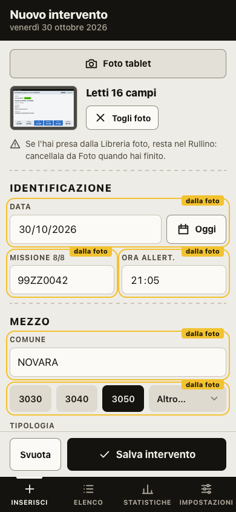
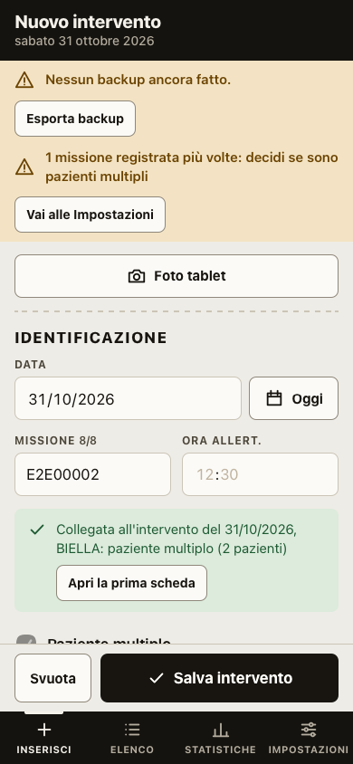

# Interventi 118

Registro personale delle uscite 118 in ambulanza ed elisoccorso. Sostituisce il file
`Report Interventi 118 2026 v3.xlsx` e, per le missioni in elicottero, la parte di volo di `Report Voli HEMS 2026.xlsx`:

- inserimento rapido da iPhone, con una mano, anche da una foto della schermata "Missione" del tablet;
- interventi con più pazienti: una scheda per paziente, contati come un intervento;
- elenco con ricerca e filtri;
- statistiche identiche a quelle dei fogli Excel, compresi tempo di volo e manovre;
- domande libere all'archivio ("qual è l'ora in cui esco di più?"), con la risposta calcolata sul telefono.

È una app web installabile (PWA): dopo il primo caricamento funziona anche senza rete.
**I dati restano solo sul dispositivo.** Nessun account, nessuna statistica d'uso. I dati escono solo quando esporti un file. Unica eccezione, solo quando la usi: per le [domande all'archivio](#domande-allarchivio) partono il testo della domanda, le voci delle liste e i nomi dei comuni, mai gli interventi.

| Inserimento | Elenco | Statistiche |
|---|---|---|
|  |  |  |

Gli screenshot usano dati inventati.

---

## Indice

1. [Avvio in locale](#avvio-in-locale)
2. [Primo import dei dati dall'Excel](#primo-import-dei-dati-dallexcel)
3. [Volo ed elisoccorso](#volo-ed-elisoccorso)
4. [Foto del tablet](#foto-del-tablet)
5. [Tipologia India/Mike](#tipologia-indiamike)
6. [Interventi con più pazienti](#interventi-con-più-pazienti)
7. [Domande all'archivio](#domande-allarchivio)
8. [Pubblicazione su Cloudflare Pages](#pubblicazione-su-cloudflare-pages)
9. [Installazione su iPhone](#installazione-su-iphone)
10. [Backup e passaggio dei dati tra Mac e iPhone](#backup-e-passaggio-dei-dati-tra-mac-e-iphone)
11. [Test](#test)
12. [Come sono calcolate le statistiche](#come-sono-calcolate-le-statistiche)
13. [Struttura del progetto](#struttura-del-progetto)
14. [Limiti noti](#limiti-noti)

---

## Avvio in locale

Serve solo **Python 3**, già presente su macOS. Per i test serve anche **Node.js 24** o superiore.

```bash
python3 tools/server_sviluppo.py
```

Apri <http://localhost:8118/> in Safari.

Il server di sviluppo non usa cache, quindi ogni ricarica prende i file appena modificati.
L'app però registra un *service worker*, che conserva i file per l'uso offline. Se dopo una modifica vedi ancora la versione vecchia, ricarica due volte. In alternativa, da Safari apri Sviluppo → Svuota cache.

Per provare l'app con dati inventati, crea il file demo (90 interventi finti):

```bash
node tools/genera_demo.mjs
```

Poi caricalo da **Impostazioni → Importa backup** scegliendo `tests/fixtures/demo.json`.

---

## Primo import dei dati dall'Excel

I 212 interventi del 2026 si portano nell'app con uno script. Usa solo Python, senza librerie da installare, e non modifica mai il file Excel:

```bash
python3 tools/xlsx_to_json.py
```

Lo script crea `data/interventi_import.json`, nel formato di backup dell'app. Poi verifica che le statistiche ricalcolate coincidano con il foglio "Statistiche":

```bash
python3 tools/attese_statistiche.py
```

Deve rispondere `✓ 475 valori coincidono con il foglio Statistiche`.

Infine importa `data/interventi_import.json` in ogni dispositivo, da **Impostazioni → Importa backup**.

- Gli identificativi degli interventi sono fissi: importare lo stesso file su Mac e iPhone, o importarlo due volte, **non crea doppioni**.
- Su iPhone l'import va fatto dall'app installata nella schermata Home (vedi [Installazione su iPhone](#installazione-su-iphone)).

> ⚠️ `data/` e il file `.xlsx` contengono dati sanitari reali. Sono esclusi da git (`.gitignore`) e non devono finire nel repository né in posti condivisi. Spostali solo nel tuo iCloud Drive personale.

---

## Volo ed elisoccorso

Per le missioni in elicottero (mezzo **V-ECHO**, **T-ECHO**, **C-ECHO** o **A-ECHO**) il form mostra la sezione **Volo**, dopo "Tempi":

- **Tipo missione:** HEMS, HSR o IFT. È una lista come le altre: si modifica da Impostazioni.
- **Tempo di volo (min):** i minuti totali di volo della missione. Comprende il rientro in base, quindi può superare la durata.
- **Manovre:** HD Hovering discesa, VD Verricello discesa, HS Hovering salita, VS Verricello salita, VSP Verricello salita pannolone, VSB Verricello salita barella. Un tocco accende la manovra, il secondo la spegne; se ne possono scegliere più di una.

Se passi da un elicottero all'altro i dati di volo restano; se scegli un'ambulanza si svuotano. Per le missioni in elicottero ci sono tre avvisi in più: **Tipo missione mancante**, **Tempo volo mancante** e **Tempo volo non valido** (deve essere un numero intero da 0 a 600, come nell'Excel HEMS). In un [intervento con più pazienti](#interventi-con-più-pazienti) il tempo di volo è uno solo: una scheda con un tempo diverso da quello della prima ha l'avviso **Tempo volo diverso tra le schede**.

### Statistiche di volo

In **Statistiche**, sotto il periodo, c'è l'interruttore **Interventi | Volo**. La vista Volo conta solo le missioni in elicottero del periodo e rifà le tabelle di volo del foglio "Statistiche" dell'Excel HEMS, con le stesse formule:

- **Basi:** le missioni sono gli interventi in elicottero del periodo; le statistiche del tempo contano solo le missioni con il tempo di volo compilato.
- **KPI:** missioni (per ognuno dei quattro elicotteri), ore di volo, volo medio con la mediana, missioni con almeno una manovra.
- **Tabelle:**
  - V1 Tempo di volo: totale, media, mediana, minimo, massimo;
  - V2 Per mezzo;
  - V3 Tipo di missione, in % sulle missioni con il tipo compilato;
  - V4 Manovre, in % sulle missioni (in un intervento con più pazienti le manovre di tutte le schede si sommano);
  - V5 Per mese.
- **Grafici:** ore di volo per mese, manovre, missioni per mezzo.

Le ore sono in ore:minuti, come il formato `[h]:mm` dell'Excel. Codici colore, patologie, luoghi, esito e orari delle missioni in elicottero restano nella vista Interventi, insieme a quelli delle ambulanze.

### Import dei voli dall'Excel HEMS

Le missioni in elicottero sono già nell'app, perché vengono dall'Excel del 118: lo script aggiunge solo tempo di volo, tipo di missione e manovre. Non modifica mai i file di partenza.

1. **iPhone:** **Impostazioni → Esporta backup** e salvalo in iCloud Drive. Lo script lavorerà sui dati di oggi.
2. **Mac:** lancia lo script con l'Excel HEMS e quel backup:

   ```bash
   python3 tools/hems_to_json.py "Report Voli HEMS 2026.xlsx" --base "percorso/del/backup.json"
   ```

   Per ogni riga del foglio "Voli" scrive l'esito:
   - `completata`;
   - `già completa`;
   - `senza codice missione`;
   - `non trovata`;
   - `trovata più volte`.

   Se data, mezzo o comune non coincidono con l'intervento trovato, lo segnala.
3. Lo script crea `data/voli_import.json` con i soli interventi completati. Importalo **sull'iPhone da cui hai esportato il backup** (Impostazioni → Importa backup), poi fai il solito giro di backup verso il Mac.
4. Le righe non completate le completi a mano dal form, aprendo l'intervento o inserendolo se manca.

Se modifichi uno di quegli interventi sul telefono tra l'export del punto 1 e l'import del punto 3, vince la versione dello script e il riepilogo dell'import la elenca tra i conflitti.

---

## Foto del tablet

In cima a **Nuovo intervento** c'è il pulsante **Foto tablet**: fotografi la schermata "Missione" del tablet SaveOnBoard e il modulo si riempie con quello che l'app riesce a leggere. Controlli, correggi quello che serve e salvi come sempre. Il pulsante non compare quando modifichi un intervento già salvato.



Lo screenshot usa una schermata inventata.

### Come si usa

1. Tocca **Foto tablet**: il menu di iOS offre **Scatta foto** e **Libreria foto**.
2. Fotografa lo schermo dritto, intero e senza riflessi. Il pulsante mostra l'avanzamento ("Leggo la foto… 40%"); la lettura richiede qualche secondo. Se la foto arriva girata (il telefono tenuto in piano sopra il tablet, o una foto già girata nella libreria), l'app la gira da sola e lo dice ("Leggo la foto girata… 40%"): ci mette un po' di più.
3. Compare il riquadro con la miniatura, quanti campi sono stati letti e l'elenco dei **Non letti**. Toccando la miniatura rivedi la foto intera; **Togli foto** chiude il riquadro, e i valori restano nel modulo.
4. I campi letti prendono il posto di quelli già nel modulo e sono evidenziati con **dalla foto**, finché non li tocchi o non salvi. Ricontrolli quelli evidenziati e completi quelli non letti.

Se la missione è già in archivio, sotto la foto compare subito un avviso con **Apri**. Se la foto non si apre o non contiene la schermata "Missione", un messaggio lo dice e il modulo non cambia.

### Cosa legge

Gli esempi usano valori inventati.

| Campo | Da dove | Esempio |
|---|---|---|
| Missione | la parte prima della `/` in "Missione in corso", se è di 2 cifre, 2 lettere e 4 cifre | `99ZZ0042/1` → `99ZZ0042` |
| Mezzo | le cifre dopo `N0`, se sono una voce della lista Mezzo | `N03050` → `3050` |
| Data | la barra di stato in alto, cioè il giorno in cui hai scattato la foto; il giorno prima se l'ora di allarme è più avanti dell'ora della barra | `06:15 Sab 31 Ott`, allarme 22:50 → 30/10 |
| Ora allert. | il riquadro **Allarme** | `21:05` |
| Libero operativo | il riquadro **Operativo** | `22:10` |
| Comune | il testo dopo il numero civico dell'indirizzo, fino a dove comincia la colonna Valutazione | `VIA DELLE PROVE, 12 NOVARA` → `NOVARA` |
| Codice, Patologia, Luogo | il codice del riquadro Valutazione, che è quello di rientro: va sia nell'invio sia nel rientro, il NERO solo nel rientro (l'invio non ce l'ha) | `V 09 L` → VERDE, `09 - …`, `L - …`; `N 19 Z` → NERO nel rientro |
| Età | la riga "Data di nascita", con "N anni": il tablet conta un anno indietro, quindi N + 1 | `40 anni` → `41` |
| Sesso | la riga "Sesso", riletta ingrandita insieme a "Data di nascita" | `M` → Maschio |
| Esito | **Trasportato** se sotto **Arrivo H** c'è un orario | `21:52` → Trasportato |
| Ospedale | solo con esito Trasportato, e solo se il testo corrisponde a una voce della lista Ospedale | `OSP. MAGGIORE NOVARA` → Novara |
| Tipologia | non dal tablet: la imposta la [regola India/Mike](#tipologia-indiamike) dopo mezzo e ora allert. | |

- **Niente viene indovinato.** Un valore illeggibile o fuori formato lascia il campo com'era e finisce tra i **Non letti** (l'elenco riguarda Data, Missione, Mezzo, Ora allert., Libero operativo, Comune, Codice, Patologia, Luogo, Età e Sesso; codice, patologia e luogo contano come letti se c'è il rientro).
- **Data.** La barra di stato non mostra l'anno: è quello che porta la data a oggi o prima. La data vale solo se anche il giorno della settimana torna, così un giorno letto male non passa. Se la barra non si legge, la data è quella del telefono (oggi, o ieri se l'allarme è più avanti dell'ora attuale) e compare tra i **Non letti**: controllala, soprattutto se la foto viene dalla libreria.
- **Orari.** Ogni orario è quello scritto sotto la sua etichetta. Se c'è l'etichetta **Allarme**, la fila degli orari si legge tre volte: sulla foto intera e su due ritagli ingranditi, uno normale e uno invertito (per le scritte chiare sui riquadri scuri). Se due letture danno orari diversi, l'orario resta vuoto. Un'etichetta letta male in un ritaglio ("Alame") non conta: l'orario resta a quella giusta.
- **Codice.** Il riquadro ha il colore del codice: verde, giallo, rosso o nero. Sul colore (per esempio la scritta nera sul verde) la foto intera spesso non lo legge. Se c'è l'etichetta **Valutazione**, l'app guarda il colore dentro il riquadro alla sua destra e rilegge il riquadro ingrandito dalla foto a colori, due volte: una con il canale più alto (scritta scura su colore acceso) e una tenendo nera solo la scritta chiusa nel riquadro, anche bianca sul rosso o sul nero. Se due letture danno codici diversi, codice, patologia e luogo restano vuoti.
- **Colore e lettera.** Il colore del riquadro controlla la lettera: se non tornano (lettera V su un riquadro giallo), il codice resta vuoto. Se la lettera non si legge, basta il colore verde, giallo o rosso; il nero no, perché un riquadro scuro può essere solo una foto buia: serve la N.
- **Indirizzo.** È la riga più vicina sopra "SCALA … PIANO …" con un numero civico: a volte il lettore mette in mezzo una riga di segni. Sulla stessa riga, a destra, c'è la prima riga della colonna Valutazione ("Coscienza Si"), spesso letta male: le parole oltre il bordo della colonna (dove stanno Valutazione, Coscienza, …, Sesso, Data di nascita) non fanno parte dell'indirizzo.
- **Sesso.** Nella foto intera la F da sola è piccola e spesso si legge male: se c'è "Data di nascita", le righe Sesso e Data di nascita si rileggono ingrandite. Una F letta "E" vale F, perché sul tablet ci sono solo M e F. Letto in due modi diversi (M e F), il sesso resta vuoto.
- **Comune.** Se l'indirizzo finisce con parole di due lettere ("… DA PO") il comune vale solo se è già nell'archivio, con o senza quelle parole: un nome troncato non si inventa. Un nome nuovo vale solo se è fatto di lettere (anche accentate, con apostrofo o trattino): con una cifra o un segno rimasti resta non letto ("N0VARA"), salvo che, tolti i segni, sia un comune già nell'archivio ("NOVARA." diventa NOVARA, scritto come nell'archivio).
- **Foto girata.** Il lettore non legge il testo girato, e l'orientamento scritto nella foto non basta: con il telefono tenuto in piano sopra il tablet il giroscopio può segnarla girata, e una foto della libreria può esserlo già. Se nella foto com'è non si riconosce la schermata (le parole fisse: Allarme, Partenza, Operativo, Valutazione, Coscienza, "Data di nascita", Ospedale…), l'app la riprova girata di 90°, 180° e 270°, prima le rotazioni più probabili (una foto verticale è quasi di sicuro girata di un quarto), finché la schermata si riconosce. Ogni tentativo costa una lettura in più.
- **Non letti per scelta.** Partenza, Arrivo e Partenza H non servono, perché l'app non ha quei campi. Tipo missione, tempo di volo e manovre degli elicotteri non sono sullo schermo e si compilano a mano.

### La foto non esce dal telefono

- La lettura avviene sul dispositivo. La foto e il testo letto non vengono inviati da nessuna parte.
- L'app non salva la foto: non finisce nell'intervento, nella bozza, nei backup né nell'export. La miniatura sta solo in memoria e sparisce con il riquadro.
- La foto mostra dati di un paziente. Se la scegli da **Libreria foto**, era già nel Rullino e ci resta: l'app non può cancellarla. Un avviso fisso sotto la miniatura lo ricorda: cancellala da Foto quando hai finito.

### Primo uso e offline

Il lettore è Tesseract.js 7.0.0 (licenza Apache 2.0), copiato in `vendor/tesseract-7.0.0/` come le altre librerie. Ogni dispositivo ne scarica circa **6 MB**, una volta sola, insieme all'app: motore di lettura e lingua italiana. La cartella è più grande perché contiene le tre varianti del motore; il dispositivo ne scarica una sola, quella che userà.

- Questi file stanno in una cache a parte (`lettore-testo-7.0.0`) che un aggiornamento dell'app non cancella né riscarica.
- Dopo il primo caricamento la lettura funziona anche senza rete.
- Se tocchi **Foto tablet** prima che il lettore sia stato scaricato, il messaggio chiede di aprire l'app una volta con la rete e di riprovare.
- Il lettore si avvia al primo tocco di **Foto tablet** e si chiude uscendo dal modulo.

### Prova su una foto vera

Le prove automatiche usano una schermata finta con dati inventati. Per vedere come legge una foto vera, solo sul Mac e solo in WebKit, c'è una prova a parte:

```bash
FOTO_TABLET=/percorso/fuori/dal/repository/foto.jpg node --test tests/e2e/foto-vera.e2e.mjs
```

Stampa nel terminale i valori del modulo, i **Non letti** e i secondi impiegati, da confrontare a occhio con la foto. Non scrive nessun file e non fa screenshot; senza `FOTO_TABLET` viene saltata, e non fa parte di `npm run e2e`.

La foto ha dati veri di un paziente: tienila fuori dal repository, in una cartella temporanea, e cancellala alla fine. Se è in formato HEIC, convertila prima:

```bash
T=$(mktemp -d) && sips -s format jpeg foto.HEIC --out "$T/tablet.jpg"
```

---

## Tipologia India/Mike

La tipologia si imposta da sola quando scegli il mezzo o l'ora di allertamento, a mano o dalla foto:

| Mezzo | Tipologia |
|---|---|
| 3040, 5022, 5024 | India sempre |
| 3050 | Mike con ora allert. dalle 08:00 alle 19:59, India dalle 20:00 alle 07:59 |
| 6021 | Mike con ora allert. dalle 20:00 alle 07:59, India dalle 08:00 alle 19:59 |
| tutti gli altri, elicotteri compresi | Mike sempre |

- **Cambiando il mezzo** la tipologia diventa quella della regola. Per 3050 e 6021 serve un'ora allert. valida: senza, la tipologia si svuota fino a quando la inserisci.
- **Cambiando l'ora allert.** la tipologia si ricalcola solo per 3050 e 6021: per gli altri mezzi una scelta fatta a mano resta com'è.
- La tipologia si può sempre cambiare a mano, e non c'è nessun avviso nuovo.
- Gli interventi già salvati non cambiano: la regola agisce solo quando cambi mezzo o ora nel modulo.
- 3050 e 6021 sono voci di sistema della lista Mezzo, come 3040, 5022 e 5024: la regola si basa sul nome, quindi non si possono rinominare né disattivare.

---

## Interventi con più pazienti

Un intervento può avere più pazienti: stessa MISSIONE, stessi allarmi, stessa uscita; cambiano codice colore, patologia, esito, età e sesso. Ogni paziente ha la sua scheda, tutte con la stessa MISSIONE, senza suffissi.

| Scheda collegata |
|---|
|  |

### Come si usa

1. Sulla **prima scheda**, la prima salvata, attiva **Paziente multiplo** (sotto MISSIONE e Ora allert.) e scrivi il **Numero pazienti**: l'app propone 2.
2. Per un altro paziente apri una scheda dell'intervento e tocca **Aggiungi paziente**. Si apre una scheda nuova con data, ora allert., missione, comune, mezzo, tipologia, invio CO (codice, patologia, luogo), libero operativo, tipo missione e tempo di volo già scritti, copiati dalla prima scheda; età, sesso, esito, ospedale, rientro e manovre sono vuoti. Tutto resta modificabile.
3. Va bene anche **Nuovo intervento** con la stessa MISSIONE: appena il numero coincide, la scheda si collega da sola. Lo dice il riquadro verde "Collegata all'intervento del 12/10/2026, BIELLA: paziente multiplo (3 pazienti)", con il link alla prima scheda. Se data e comune non sono quelli giusti, la MISSIONE ha un refuso. La foto del tablet mostra lo stesso riquadro verde invece dell'errore rosso.

### Regole

- **Senza la spunta sulla prima scheda** resta l'errore di sempre, "La MISSIONE … è già registrata", con l'indicazione di attivare Paziente multiplo sulla prima scheda: il controllo dei refusi non cambia.
- **Scheda collegata:** spunta e numero vengono dalla prima scheda e sono bloccati. Cambiando la MISSIONE il legame si scioglie e la spunta si spegne.
- **Prima scheda:** finché ha altre schede collegate, MISSIONE e spunta sono bloccate ("Collegata a 2 altre schede"). Il numero si cambia lì, e al salvataggio passa sulle altre schede. La prima scheda è la prima salvata (a parità d'istante decide l'id), quindi è la stessa su Mac e iPhone dopo uno scambio di backup.
- **Numero pazienti:** con la spunta accesa è obbligatorio. Se lo cancelli il salvataggio si ferma ("Scrivi il numero di pazienti, oppure togli Paziente multiplo."); un numero non valido (1, 2,5, un testo) si salva con un avviso.
- **Eliminare una scheda** si può sempre e non tocca le altre. Se resta solo la prima scheda, la sua spunta torna libera.
- **Elenco:** ogni scheda dice "Paziente 1 di 3", "Paziente 2 di 3"…, in righe separate. In cima, "N interventi · M schede".
- **Avvisi**, che non bloccano: **Schede in più rispetto ai pazienti**, **Mancano schede paziente**, **Numero pazienti non valido**, **Numero pazienti diverso tra le schede** (può nascere da uno scambio di backup) e, per gli elicotteri, **Tempo volo diverso tra le schede**.
- **Excel:** la colonna PAZIENTI, subito dopo MISSIONE, ha il numero su tutte le schede dell'intervento ed è vuota per l'intervento singolo. `tools/xlsx_to_json.py` legge sia questo tracciato sia quello del foglio 118, senza la colonna.
- **Backup:** passa alla versione 3. Aggiorna l'app su tutti e due i dispositivi prima di scambiare i backup.

### Missioni già registrate più volte

Niente si collega da solo. In **Impostazioni**, la sezione **Stessa missione registrata più volte** elenca le schede con la stessa MISSIONE la cui prima scheda non ha la spunta: per esempio un intervento con due pazienti registrato prima della versione 1.5.0, o due schede arrivate con un import. Per ogni gruppo scegli:

- **Stesso intervento:** le schede diventano pazienti dello stesso intervento, con il numero di pazienti uguale al numero di schede;
- **Refuso:** il gruppo esce dall'elenco e l'avviso "Missione duplicata" resta finché non correggi la MISSIONE dalla scheda. Vale solo sul dispositivo dove lo scegli: sull'altro il gruppo resta da decidere.

Sotto ci sono gli interventi già collegati, con **Scollega** per tornare a schede separate con l'avviso "Missione duplicata", e le ultime decisioni prese. Finché ci sono gruppi da decidere, la striscia in cima all'app lo ricorda, con **Vai alle Impostazioni**. "Stesso intervento" e "Scollega" cambiano le schede e viaggiano con il backup; "Refuso" e l'elenco delle decisioni restano sul dispositivo.

---

## Domande all'archivio

In cima alle **Statistiche** c'è il riquadro **Fai una domanda**: scrivi in italiano, per esempio "qual è l'ora in cui esco di più?", "in quale giorno ho fatto più interventi?", "durata media per mezzo nel 2025", "più rossi quest'anno o l'anno scorso?". L'app risponde con i numeri del tuo archivio: la cifra in grande, come ha inteso la domanda e su quale periodo, poi la classifica o la tabella (e un grafico quando ci sono almeno tre voci).

### Come funziona

1. La domanda va al Worker dell'app su Cloudflare, che la passa a Claude (Anthropic, modello Haiku; se la risposta non è valida riprova una volta con Sonnet).
2. Claude non vede i dati: traduce la domanda in una **query**, cioè una descrizione precisa di cosa contare (misura, raggruppamento, filtri, periodo).
3. Il telefono esegue la query sul suo archivio, con le stesse regole delle Statistiche, e scrive la risposta.

Se la domanda non nomina un periodo vale quello scelto nella pagina; la risposta dice sempre su quale periodo è calcolata. Se la domanda è ambigua Claude fa **una** controdomanda, a cui rispondi nello stesso riquadro. Se non si può calcolare con i campi dell'app, propone tre domande simili. Domanda e risposta non vengono salvate: lasciando la pagina spariscono.

### Cosa parte dal telefono

Solo il testo della domanda, le voci delle liste delle Impostazioni (mezzi, ospedali, patologie…) e i nomi dei comuni presenti in archivio. **Mai gli interventi.** Non scrivere nelle domande dati dei pazienti: Anthropic conserva per un periodo limitato il testo che riceve, secondo la sua politica. Senza rete il riquadro è spento e lo dice; il resto dell'app funziona offline come sempre.

### Prima configurazione (una volta sola, dal Mac)

Servono una chiave di Anthropic e una parola d'ordine scelta da te. Restano segrete su Cloudflare: non sono nel codice né nel repository.

1. Su <https://console.anthropic.com> crea una chiave (**API Keys → Create Key**) e imposta un **tetto di spesa mensile** (**Settings → Limits**), per esempio 5 dollari: ogni domanda costa una frazione di centesimo.
2. Dal Terminale, **da una cartella fuori dal progetto**, salva la chiave su Cloudflare (Wrangler chiede di incollarla e non la mostra):

   ```bash
   cd ~ && npx --yes wrangler@4.156.0 secret put CHIAVE_ANTHROPIC --name liberoeoperativo
   ```

3. Allo stesso modo salva la parola d'ordine. Il servizio è raggiungibile da chiunque conosca l'indirizzo, quindi deve essere difficile da indovinare: **almeno 12 caratteri**, per esempio tre parole a caso separate da spazi (non un nome, non una data, non le parole di questo esempio). Con una parola più corta il servizio non parte e lo dice; a ogni parola sbagliata risponde dopo un secondo, per rallentare chi prova a indovinarla.

   ```bash
   cd ~ && npx --yes wrangler@4.156.0 secret put PAROLA_ORDINE --name liberoeoperativo
   ```

4. Sull'iPhone e sul Mac: **Impostazioni → Domande all'archivio**, scrivi la stessa parola d'ordine e tocca **Salva**. La parola resta sul dispositivo e non entra nei backup. Il tetto di spesa del punto 1 resta la rete di sicurezza: anche nel caso peggiore non si spende più di quello.

Senza questi passi l'app funziona come prima; il riquadro dice cosa manca. Se cambi la parola d'ordine su Cloudflare, cambiala anche nelle Impostazioni di ogni dispositivo (**Cambia**).

---

## Pubblicazione su Cloudflare Pages

L'app è un insieme di file statici: Cloudflare la ospita gratis, a un indirizzo tutto suo:
<https://liberoeoperativo.wolftux.workers.dev>. L'indirizzo è `<nome app>.<nome account>.workers.dev`:
il nome dell'app è in `tools/pubblica.sh`, quello dell'account (`wolftux`, uguale per tutte le app dell'account) si cambia
su Cloudflare in **Workers & Pages → Your subdomain → Change**.
Un indirizzo che non condivide con altre app conta: il browser separa dati e cache per indirizzo.

Si pubblica dal Mac, con un comando:

```bash
npm run pubblica
```

Il comando ([tools/pubblica.sh](tools/pubblica.sh)):

1. si ferma se non sei su `main` o se ci sono modifiche senza commit;
2. esegue i test;
3. copia dall'ultimo commit **solo i file dell'app** in una cartella temporanea fuori dal progetto: `index.html`, `manifest.webmanifest`, `sw.js` e le cartelle `css/`, `js/`, `vendor/`, `icons/`; accanto, il Worker `worker/domande.js` e una configurazione minima (`wrangler.jsonc`) scritta lì;
4. prova a secco il Worker, poi carica tutto su Cloudflare con Wrangler, lanciato da quella cartella e senza configurazione automatica;
5. controlla che dati, Excel e file di progetto rispondano 404 (se uno risponde, toglie subito la pubblicazione) e che le [domande all'archivio](#domande-allarchivio) senza parola d'ordine vengano rifiutate.

**Non lanciare mai Wrangler nella cartella del progetto.** Con la configurazione automatica pubblicherebbe tutta la cartella, dati reali compresi.

Test, strumenti, documenti e appunti di progetto restano nel repository ma non finiscono sul sito.

**Privacy.** I dati reali sono esclusi da `.gitignore` e il comando pubblica solo file presenti nei commit, quindi non possono finire online. Il sito pubblicato non riceve né contiene dati: ogni dispositivo tiene i suoi in locale. Il push su GitHub non pubblica niente: serve solo a tenere una copia del codice.

### Prima pubblicazione

1. Collega il Mac al tuo account Cloudflare, da una cartella fuori dal progetto (si apre il browser per il consenso):

   ```bash
   cd ~ && npx wrangler@4.156.0 login
   ```

2. Pubblica con `npm run pubblica`: la prima volta crea anche il progetto. L'indirizzo dell'app compare alla fine.

### Aggiornare l'app

1. Modifica i file.
2. In `sw.js` cambia `VERSIONE`, per esempio `interventi118-v1.0.1`: è il segnale che fa scaricare la nuova copia ai dispositivi.
3. Fai il commit su `main` e lancia `npm run pubblica`.
4. Sui dispositivi la nuova versione arriva alla seconda apertura dell'app: la prima scarica i file, la seconda li usa.

Se aggiungi un file all'app, inseriscilo nell'elenco `FILE` di `sw.js`; se aggiungi una cartella, anche nella riga `git archive` di `tools/pubblica.sh`. Un test (`tests/pwa.test.js`) segnala se te ne dimentichi.

I file del lettore della [foto del tablet](#primo-uso-e-offline) hanno una cache a parte, che non cambia con `VERSIONE`: così un aggiornamento non riscarica i 6 MB. Se cambi versione di Tesseract, cambiano insieme la cartella in `vendor/` e il nome `LETTORE` in `sw.js`.

---

## Installazione su iPhone

1. Apri l'indirizzo dell'app in **Safari**: l'installazione funziona solo da Safari.
2. Tocca **Condividi** (il quadrato con la freccia), poi **Aggiungi alla schermata Home**, poi **Aggiungi**.
3. Apri l'app dall'icona del cartellino 118. Da qui funziona anche senza rete.
4. **Importa i dati dall'app installata.** L'app nella schermata Home ha un archivio suo, separato da quello di Safari: i dati importati in una scheda di Safari non si vedono nell'app installata, e viceversa.

In **Impostazioni → Archiviazione sul dispositivo** vedi se iOS ha concesso l'archiviazione persistente. Con l'app installata di solito è "Concessa": il sistema non cancellerà i dati per liberare spazio. Il backup resta comunque l'unica copia fuori dal telefono.

**Sul Mac** puoi usare l'app in una scheda di Safari, oppure aggiungerla al Dock da Safari con **File → Aggiungi al Dock**. Anche qui l'app nel Dock ha un archivio separato da quello delle schede: scegli un modo e importa i dati lì. Attenzione: cancellare i "dati dei siti web" di Safari cancella anche i dati dell'app.

---

## Backup e passaggio dei dati tra Mac e iPhone

Non c'è sincronizzazione automatica né backup in rete, per scelta: l'app la useranno anche colleghi e nessun archivio comune è accettabile. I dati passano da un dispositivo all'altro con un **file di backup JSON** salvato su iCloud Drive.

Il file ha un **nome fisso per dispositivo**: `interventi118_iPhone.json` dall'iPhone, `interventi118_Mac.json` dal Mac. Salvandolo sempre nella stessa cartella, il sistema chiede di sostituire il file: il backup resta uno solo per dispositivo e non ci sono file vecchi da cancellare. I due file sono anche i file di scambio: ogni dispositivo importa quello dell'altro.

### Dall'iPhone al Mac

1. iPhone: **Impostazioni → Esporta backup**. Si apre la condivisione: scegli **Salva su File**, poi la cartella di **iCloud Drive** (ad esempio "Interventi 118"), poi **Salva**. Dalla seconda volta iOS chiede di sostituire `interventi118_iPhone.json`: tocca **Sostituisci**.
2. Mac: apri l'app, **Impostazioni → Importa backup** e scegli `interventi118_iPhone.json` da iCloud Drive.

### Dal Mac all'iPhone

1. Mac: **Impostazioni → Esporta backup**. Il file si chiama `interventi118_Mac.json` (vedi sotto dove finisce).
2. iPhone, dall'app installata: **Impostazioni → Importa backup → Sfoglia → iCloud Drive** e scegli `interventi118_Mac.json`.

### Sul Mac: Safari o Chrome

- **Safari** scarica nei Download e, se il file c'è già, lo rinomina in `interventi118_Mac-1.json`, `-2` e così via: l'app non può evitarlo. Rimedio: in Safari apri **Impostazioni → Generali → Posizione download** e scegli **Chiedi per ogni download**. A ogni esportazione scegli la cartella di iCloud Drive e il Mac chiede di sostituire il file.
- **Chrome ed Edge** aprono la finestra di salvataggio con il nome già scritto: la prima volta scegli la cartella (per esempio in iCloud Drive). Le volte dopo l'app **riscrive quel file da sola**, senza chiedere. Se il file non c'è più (spostato, rinominato) o il browser non dà il permesso, si riapre la finestra di scelta e l'app ricorda la nuova posizione. Backup ed Excel hanno ciascuno il proprio file ricordato.

### Cosa succede all'import

L'import **unisce** i dati, non sostituisce mai l'archivio:

- **Interventi nuovi:** vengono aggiunti.
- **Interventi presenti su entrambi i dispositivi:** vince la versione modificata più di recente.
- **Interventi eliminati sull'altro dispositivo:** vengono eliminati anche qui.
- **Interventi presenti solo sul dispositivo di arrivo:** restano.
- **Liste dei menu:** le voci aggiunte o rinominate viaggiano insieme ai dati.

A fine import compare il riepilogo:

- **Nuovi**, **Aggiornati**, **Invariati**;
- **Conflitti:** lo stesso intervento modificato su tutti e due i dispositivi dall'ultimo scambio. Viene tenuta la versione più recente e l'elenco dice quali erano;
- **Stessa missione registrata più volte:** succede se hai inserito lo stesso intervento su Mac e iPhone. Restano entrambi, con l'avviso "Missione duplicata": se è lo stesso paziente, eliminane uno; se sono pazienti diversi dello stesso intervento, collegali dalla sezione [Stessa missione registrata più volte](#missioni-già-registrate-più-volte) delle Impostazioni. Le schede di un intervento con più pazienti non compaiono qui.

**Consiglio:** se hai lavorato su un solo dispositivo, esporta da lì e importa nell'altro. Se hai lavorato su entrambi, fai il giro completo: esporta da A e importa in B, poi esporta da B e importa in A. Alla fine i due archivi sono identici.

### Promemoria e archivio

- Nell'app compare un promemoria quando l'ultimo backup ha più di **7 giorni** o ci sono più di **10 modifiche** non esportate.
- **Esporta copia con data** crea `interventi118_AAAA-MM-GG_HHMM.json`, per chi vuole conservare una copia storica accanto al file fisso. Conta come backup (azzera il promemoria); in Chrome la finestra di salvataggio si apre ogni volta.
- **Esporta Excel** crea `interventi118_iPhone.xlsx` o `interventi118_Mac.xlsx`, con la stessa regola del nome fisso, e le stesse colonne del foglio "Interventi", comprese quelle calcolate. Serve per l'archivio, **non** è un backup da reimportare: per quello usa il JSON.
- Se perdi o cambi il telefono, i dati sono nell'ultimo backup su iCloud Drive: installa l'app sul nuovo iPhone e importalo.

---

## Test

```bash
npm test
```

Esegue i test unitari (oltre 270) con `node --test`. Coprono:

- campi calcolati, compresa la durata a cavallo della mezzanotte;
- controlli di qualità, compresi quelli di volo;
- statistiche, comprese quelle di volo;
- merge con conflitti ed eliminazioni, anche tra backup vecchi e nuovi;
- regola India/Mike per mezzo e orario;
- interventi con più pazienti: prima scheda, collegamento, avvisi, statistiche per missione e per scheda, unione dei backup;
- lettura della schermata del tablet, su testi inventati;
- domande all'archivio: validazione della query, calcolo sul dispositivo e Worker con un Claude finto (nessuna chiamata vera);
- salvataggio con nome fisso e file ricordato (finestra di salvataggio finta);
- liste, export Excel, file della PWA, comportamento del service worker e script di import dei voli.

Se `data/` contiene i file creati dagli script del [primo import](#primo-import-dei-dati-dallexcel), i test confrontano anche le statistiche sui 212 interventi reali con i valori del foglio Excel. Senza quei file, quei test vengono saltati con il motivo.

Allo stesso modo, le statistiche di volo si confrontano con l'Excel HEMS:

```bash
python3 tools/attese_volo.py "Report Voli HEMS 2026.xlsx"
```

Lo script crea `data/volo_attese.json`. Da quel momento `npm test` controlla tutti i 157 valori delle tabelle di volo.

```bash
npm run e2e
```

Esegue 109 prove end-to-end in **WebKit** (il motore di Safari) e **Chromium**, a 390 e 1440 px:

- inserimento e duplicato bloccante;
- modifica, eliminazione, filtri e statistiche;
- sezione Volo del form e vista Volo delle statistiche;
- interventi con più pazienti: spunta e numero, scheda collegata con il riquadro verde, Aggiungi paziente, statistiche, decisioni sulle missioni registrate più volte e foto del tablet con la spunta;
- foto del tablet, con una schermata finta e dati inventati: campi evidenziati, missione già salvata, foto storta o sbagliata, lettore assente;
- export e reimport con merge tra due dispositivi simulati;
- export Excel, copia con data e, in Chromium, riscrittura del file ricordato;
- parola d'ordine e riquadro delle domande con risposte finte del servizio (query, controdomanda, rifiuto, errore, senza rete);
- funzionamento offline.

Le prove avviano da sole un server locale, usano solo dati inventati e salvano gli screenshot in `docs/screenshots/`.

Playwright non è una dipendenza del progetto: le prove usano quello installato sul computer, cioè il pacchetto `playwright` oppure `@playwright/cli`. In alternativa puoi indicare il percorso con `PLAYWRIGHT_CORE=/percorso/playwright-core/index.mjs`. WebKit si installa con:

```bash
npx playwright install webkit
```

Con `E2E_BROWSER=webkit npm run e2e` provi un solo motore.

---

## Come sono calcolate le statistiche

Le definizioni sono quelle del foglio "Istruzioni" e delle formule del foglio "Statistiche":

- **Interventi totali:** righe con DATA o MISSIONE. Le schede di un [intervento con più pazienti](#interventi-con-più-pazienti) contano una volta: un'uscita vale 1.
- **Pazienti valutati:** schede − "Annullato da CO" − "Non Raggiungibile".
- **Percentuali degli ospedali:** sui soli trasportati.
- **Codici VERDE < GIALLO < ROSSO:** il NERO, presente solo al rientro, è escluso dal confronto invio/rientro.
- **Durata:** libero operativo − ora di allertamento. Se il libero operativo è dopo la mezzanotte, si conta il giorno dopo.

Scelte fatte dove le formule dell'Excel erano ambigue, confermate prima di scrivere il codice:

1. **Sesso, età e fasce d'età** riproducono l'Excel così com'è: si contano su tutte le righe, ma la percentuale è sui valutati. Per questo maschi + femmine può superare di poco il 100%.
2. **Missione duplicata:** il salvataggio si blocca solo se inserisci o cambi una MISSIONE mettendo un numero già usato; un duplicato già presente resta modificabile. Il controllo guarda tutto l'archivio, non solo il periodo filtrato.
3. **Righe senza DATA:** contano solo nella vista "Tutto", non nei filtri per anno, mese o intervallo.
4. **Tabella per mese:** mostra i mesi del periodo scelto, con l'anno quando il periodo ne copre più di uno.
5. **Voci di sistema bloccate:** non si rinominano né si disattivano i 4 codici, India/Mike, Maschio/Femmina, Trasportato, Deceduto, Annullato da CO, Non Raggiungibile e i mezzi 3040, 3050, 5022, 5024, 6021, V-ECHO, T-ECHO, C-ECHO e A-ECHO. Sono le voci da cui dipendono statistiche, controlli e regola [India/Mike](#tipologia-indiamike). C-ECHO e A-ECHO non sono nel foglio "Liste" dell'Excel: l'app li aggiunge da sola in fondo alla lista Mezzo, anche su un dispositivo che aveva già le sue liste.

**Interventi con più pazienti.** Contano una volta per missione, dalla prima scheda, gli interventi e le tabelle per mese, mezzo e ora, India/Mike e le durate. Contano scheda per scheda i pazienti: valutati, codici, patologie, luoghi, esiti, ospedali, età e sesso. Le percentuali che l'Excel divide per gli interventi (annullati, invio, esiti, avvisi) qui si dividono per le schede: senza interventi multipli schede e interventi coincidono e i numeri sono quelli dell'Excel. Nel riepilogo ci sono due righe in più, **Interventi con più pazienti** e **Pazienti negli interventi multipli**; il KPI Interventi aggiunge "N con più pazienti". Nella vista Volo il tempo di volo conta una volta per missione e le manovre di tutte le schede si sommano. Un gruppo di schede con la stessa MISSIONE ma senza la spunta resta un duplicato e conta per riga, come nell'Excel.

Le statistiche di volo seguono il foglio "Statistiche" dell'Excel HEMS: vedi [Statistiche di volo](#statistiche-di-volo).

---

## Struttura del progetto

```
index.html, manifest.webmanifest, sw.js   app, installazione, cache offline
css/app.css                               stile (sistema visivo descritto in DESIGN.md)
js/core/       logica pura, senza interfaccia, coperta dai test:
               campi, calcolati, controlli, statistiche, volo, merge, liste, elenco, modulo, excel, tablet, domande,
               pazienti (gruppo di schede di una MISSIONE, prima scheda, collegamento)
js/ui/         schermate: inserimento, elenco, statistiche (con la vista volo e le domande all'archivio), impostazioni;
               fototablet (foto, ritocco e lettore della schermata del tablet)
worker/        Worker Cloudflare: file statici e traduzione delle domande con Claude (POST /api/domanda)
js/db.js       archivio IndexedDB          js/stato.js  stato in memoria
js/app.js      avvio e navigazione
vendor/        Chart.js 4.5.1 (MIT), SheetJS CE 0.20.3 (Apache 2.0) e Tesseract.js 7.0.0 (Apache 2.0, in tesseract-7.0.0/),
               copie locali con licenza
icons/         icona (SVG originale e PNG)
tools/         import dagli Excel 118 e HEMS, verifica statistiche, dati demo, server di sviluppo
tests/         test unitari, prove end-to-end (tests/e2e, con la prova a mano su una foto vera), dati demo e schermata finta del tablet (tests/fixtures)
docs/screenshots/   schermate delle prove end-to-end
```

---

## Limiti noti

- **Nessuna sincronizzazione automatica:** il passaggio tra Mac e iPhone avviene solo con il file di backup. Il conflitto si risolve automaticamente tenendo la modifica più recente; non c'è un'unione campo per campo.
- **Condivisione "Salva su File" su iPhone:** le prove automatiche la sostituiscono con il download. Va verificata a mano sul telefono, la prima volta che esporti.
- **Prove in WebKit, non su iPhone:** le prove automatiche girano nel motore di Safari su Mac, non su un iPhone vero. Data e ora usano i selettori nativi di iOS, che le prove non possono vedere.
- **Archivi separati:** Safari, l'app nella schermata Home e l'app nel Dock del Mac hanno archivi separati, anche sullo stesso dispositivo.
- **Pulizia di Safari:** cancellare i dati di navigazione di Safari cancella i dati dell'app aperta nel browser. Il backup regolare resta la protezione principale.
- **Backup delle versioni 1.1 e 1.5:** contengono campi nuovi (i dati di volo dalla 1.1, il numero di pazienti dalla 1.5) e un'app non ancora aggiornata li rifiuta, chiedendo di aggiornarla. Aggiorna l'app su entrambi i dispositivi prima di scambiare i backup: basta aprirla due volte con la rete.
- **Export Excel e dati di volo:** l'export contiene le colonne VOLO, ma `tools/xlsx_to_json.py` legge solo le colonne del 118. Per i passaggi tra dispositivi usa sempre il backup JSON.
- **Lettura della foto non provata su iPhone:** sia le prove automatiche sia la prova su una foto vera girano in WebKit su Mac. Tempi, menu **Scatta foto** / **Libreria foto** e primo scaricamento del lettore vanno verificati a mano sul telefono.
- **Lettura della foto: un aiuto, non una garanzia.** Il lettore può sbagliare, soprattutto con foto storte, mosse o con riflessi: i campi evidenziati vanno sempre ricontrollati. Quello che non legge o non riconosce resta vuoto.
- **Lettura degli Excel:** l'app importa solo backup JSON. Per leggere un file Excel si usa `tools/xlsx_to_json.py`, che legge il foglio "Interventi" con la struttura attuale.
- **Domande all'archivio:** servono la rete, i due segreti su Cloudflare e la parola d'ordine nelle Impostazioni. Claude può fraintendere una domanda: la riga "Inteso come" dice come l'ha capita, e la risposta vale per quella lettura. Le domande coprono i campi dell'intervento (compresi tipo missione e tempo di volo), non le altre statistiche di volo. Le prove automatiche usano risposte finte: la prima domanda vera va provata a mano dopo aver impostato i segreti.
- **Promemoria sul telefono:** a 390 px, quando è visibile, spinge la striscia dei codici di invio poco sotto la prima schermata. Con anche le missioni registrate più volte da decidere la striscia ha due righe e spinge di più, finché non decidi nelle Impostazioni.
