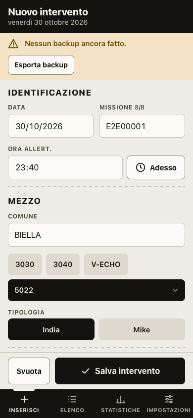
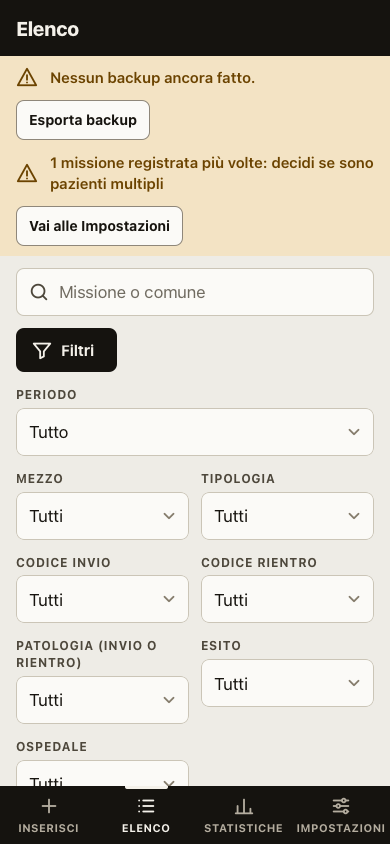

# Interventi 118

Registro personale delle uscite 118 in ambulanza ed elisoccorso. Sostituisce il file
`Report Interventi 118 2026 v3.xlsx` e, per le missioni in elicottero, la parte di volo di `Report Voli HEMS 2026.xlsx`:

- inserimento rapido da iPhone, con una mano;
- elenco con ricerca e filtri;
- statistiche identiche a quelle dei fogli Excel, compresi tempo di volo e manovre.

È una app web installabile (PWA): dopo il primo caricamento funziona anche senza rete.
**I dati restano solo sul dispositivo.** Nessun account, nessun server, nessuna statistica d'uso. I dati escono solo quando esporti un file.

| Inserimento | Elenco | Statistiche |
|---|---|---|
|  |  |  |

Gli screenshot usano dati inventati.

---

## Indice

1. [Avvio in locale](#avvio-in-locale)
2. [Primo import dei dati dall'Excel](#primo-import-dei-dati-dallexcel)
3. [Volo ed elisoccorso](#volo-ed-elisoccorso)
4. [Pubblicazione su GitHub Pages](#pubblicazione-su-github-pages)
5. [Installazione su iPhone](#installazione-su-iphone)
6. [Backup e passaggio dei dati tra Mac e iPhone](#backup-e-passaggio-dei-dati-tra-mac-e-iphone)
7. [Test](#test)
8. [Come sono calcolate le statistiche](#come-sono-calcolate-le-statistiche)
9. [Struttura del progetto](#struttura-del-progetto)
10. [Limiti noti](#limiti-noti)

---

## Avvio in locale

Serve solo **Python 3**, già presente su macOS. Per i test serve anche **Node.js 24** o superiore.

```bash
python3 tools/server_sviluppo.py
```

Apri <http://localhost:8118/> in Safari.

Il server di sviluppo non usa cache, quindi ogni ricarica prende i file appena modificati.
L'app però registra un *service worker*, che conserva i file per l'uso offline. Se dopo una modifica vedi ancora la versione vecchia, ricarica due volte. In alternativa, da Safari apri Sviluppo → Svuota cache.

Per provare l'app con dati inventati, crea il file demo (90 interventi finti):

```bash
node tools/genera_demo.mjs
```

Poi caricalo da **Impostazioni → Importa backup** scegliendo `tests/fixtures/demo.json`.

---

## Primo import dei dati dall'Excel

I 212 interventi del 2026 si portano nell'app con uno script. Usa solo Python, senza librerie da installare, e non modifica mai il file Excel:

```bash
python3 tools/xlsx_to_json.py
```

Lo script crea `data/interventi_import.json`, nel formato di backup dell'app. Poi verifica che le statistiche ricalcolate coincidano con il foglio "Statistiche":

```bash
python3 tools/attese_statistiche.py
```

Deve rispondere `✓ 475 valori coincidono con il foglio Statistiche`.

Infine importa `data/interventi_import.json` in ogni dispositivo, da **Impostazioni → Importa backup**.

- Gli identificativi degli interventi sono fissi: importare lo stesso file su Mac e iPhone, o importarlo due volte, **non crea doppioni**.
- Su iPhone l'import va fatto dall'app installata nella schermata Home (vedi [Installazione su iPhone](#installazione-su-iphone)).

> ⚠️ `data/` e il file `.xlsx` contengono dati sanitari reali. Sono esclusi da git (`.gitignore`) e non devono finire nel repository né in posti condivisi. Spostali solo nel tuo iCloud Drive personale.

---

## Volo ed elisoccorso

Per le missioni in elicottero (mezzo **V-ECHO** o **T-ECHO**) il form mostra la sezione **Volo**, dopo "Tempi":

- **Tipo missione:** HEMS, HSR o IFT. È una lista come le altre: si modifica da Impostazioni.
- **Tempo di volo (min):** i minuti totali di volo della missione. Comprende il rientro in base, quindi può superare la durata.
- **Manovre:** HD Hovering discesa, VD Verricello discesa, HS Hovering salita, VS Verricello salita, VSP Verricello salita pannolone, VSB Verricello salita barella. Un tocco accende la manovra, il secondo la spegne; se ne possono scegliere più di una.

Se cambi il mezzo e scegli un'ambulanza, i dati di volo si svuotano. Per le missioni in elicottero ci sono tre avvisi in più: **Tipo missione mancante**, **Tempo volo mancante** e **Tempo volo non valido** (deve essere un numero intero da 0 a 600, come nell'Excel HEMS).

### Statistiche di volo

In **Statistiche**, sotto il periodo, c'è l'interruttore **Interventi | Volo**. La vista Volo conta solo le missioni V-ECHO e T-ECHO del periodo e rifà le tabelle di volo del foglio "Statistiche" dell'Excel HEMS, con le stesse formule:

- **Basi:** le missioni sono gli interventi in elicottero del periodo; le statistiche del tempo contano solo le missioni con il tempo di volo compilato.
- **KPI:** missioni (per V-ECHO e T-ECHO), ore di volo, volo medio con la mediana, missioni con almeno una manovra.
- **Tabelle:**
  - V1 Tempo di volo: totale, media, mediana, minimo, massimo;
  - V2 Per mezzo;
  - V3 Tipo di missione, in % sulle missioni con il tipo compilato;
  - V4 Manovre, in % sulle missioni;
  - V5 Per mese.
- **Grafici:** ore di volo per mese, manovre, missioni per mezzo.

Le ore sono in ore:minuti, come il formato `[h]:mm` dell'Excel. Codici colore, patologie, luoghi, esito e orari delle missioni in elicottero restano nella vista Interventi, insieme a quelli delle ambulanze.

### Import dei voli dall'Excel HEMS

Le missioni in elicottero sono già nell'app, perché vengono dall'Excel del 118: lo script aggiunge solo tempo di volo, tipo di missione e manovre. Non modifica mai i file di partenza.

1. **iPhone:** **Impostazioni → Esporta backup** e salvalo in iCloud Drive. Lo script lavorerà sui dati di oggi.
2. **Mac:** lancia lo script con l'Excel HEMS e quel backup:

   ```bash
   python3 tools/hems_to_json.py "Report Voli HEMS 2026.xlsx" --base "percorso/del/backup.json"
   ```

   Per ogni riga del foglio "Voli" scrive l'esito:
   - `completata`;
   - `già completa`;
   - `senza codice missione`;
   - `non trovata`;
   - `trovata più volte`.

   Se data, mezzo o comune non coincidono con l'intervento trovato, lo segnala.
3. Lo script crea `data/voli_import.json` con i soli interventi completati. Importalo **sull'iPhone da cui hai esportato il backup** (Impostazioni → Importa backup), poi fai il solito giro di backup verso il Mac.
4. Le righe non completate le completi a mano dal form, aprendo l'intervento o inserendolo se manca.

Se modifichi uno di quegli interventi sul telefono tra l'export del punto 1 e l'import del punto 3, vince la versione dello script e il riepilogo dell'import la elenca tra i conflitti.

---

## Pubblicazione su GitHub Pages

L'app è un insieme di file statici: GitHub Pages la ospita gratis, a un indirizzo come
`https://<utente>.github.io/<repository>/`.

**Cosa viene pubblicato.** Il workflow `.github/workflows/pages.yml` pubblica **solo i file dell'app**:

- `index.html`, `manifest.webmanifest`, `sw.js`;
- le cartelle `css/`, `js/`, `vendor/`, `icons/`.

Test, strumenti, documenti e appunti di progetto restano nel repository ma non finiscono sul sito.
Prima di ogni pubblicazione il workflow esegue i test.

**Privacy.** Con il piano gratuito di GitHub, Pages funziona solo su repository **pubblici**; per un repository privato serve GitHub Pro. Nel repository c'è solo il codice: i dati reali sono esclusi da `.gitignore`. Il sito pubblicato non riceve né contiene dati: ogni dispositivo tiene i suoi in locale.

### Prima pubblicazione

1. Su <https://github.com/new> crea un repository, per esempio `interventi-118`, senza README.
2. Collega e invia il codice dalla cartella del progetto (sostituisci `<utente>`):

   ```bash
   git remote add origin https://github.com/<utente>/interventi-118.git
   ```

   ```bash
   git push -u origin main
   ```

3. Su GitHub, nel repository, apri **Settings → Pages**. In "Build and deployment" scegli **Source: GitHub Actions**.
4. Dalla scheda **Actions** controlla che "Pubblica su GitHub Pages" finisca in verde. L'indirizzo dell'app compare nel riepilogo e in Settings → Pages.

### Aggiornare l'app

1. Modifica i file.
2. In `sw.js` cambia `VERSIONE`, per esempio `interventi118-v1.0.1`: è il segnale che fa scaricare la nuova copia ai dispositivi.
3. Fai il commit e `git push`. Il workflow ripubblica da solo.
4. Sui dispositivi la nuova versione arriva alla seconda apertura dell'app: la prima scarica i file, la seconda li usa.

Se aggiungi un file all'app, inseriscilo nell'elenco `FILE` di `sw.js`; se aggiungi una cartella, anche nella riga `cp` del workflow. Un test (`tests/pwa.test.js`) segnala se te ne dimentichi.

---

## Installazione su iPhone

1. Apri l'indirizzo dell'app in **Safari**: l'installazione funziona solo da Safari.
2. Tocca **Condividi** (il quadrato con la freccia), poi **Aggiungi alla schermata Home**, poi **Aggiungi**.
3. Apri l'app dall'icona del cartellino 118. Da qui funziona anche senza rete.
4. **Importa i dati dall'app installata.** L'app nella schermata Home ha un archivio suo, separato da quello di Safari: i dati importati in una scheda di Safari non si vedono nell'app installata, e viceversa.

In **Impostazioni → Archiviazione sul dispositivo** vedi se iOS ha concesso l'archiviazione persistente. Con l'app installata di solito è "Concessa": il sistema non cancellerà i dati per liberare spazio. Il backup resta comunque l'unica copia fuori dal telefono.

**Sul Mac** puoi usare l'app in una scheda di Safari, oppure aggiungerla al Dock da Safari con **File → Aggiungi al Dock**. Anche qui l'app nel Dock ha un archivio separato da quello delle schede: scegli un modo e importa i dati lì. Attenzione: cancellare i "dati dei siti web" di Safari cancella anche i dati dell'app.

---

## Backup e passaggio dei dati tra Mac e iPhone

Non c'è sincronizzazione automatica: i dati passano da un dispositivo all'altro con un **file di backup JSON** salvato su iCloud Drive. Il nome del file contiene data e ora: `interventi118_AAAA-MM-GG_HHMM.json`.

### Dall'iPhone al Mac

1. iPhone: **Impostazioni → Esporta backup**. Si apre la condivisione: scegli **Salva su File**, poi **iCloud Drive** (ad esempio una cartella "Interventi 118"), poi **Salva**.
2. Mac: apri l'app, **Impostazioni → Importa backup** e scegli il file da iCloud Drive.

### Dal Mac all'iPhone

1. Mac: **Impostazioni → Esporta backup**. Il file finisce in Download: spostalo in iCloud Drive.
2. iPhone, dall'app installata: **Impostazioni → Importa backup → Sfoglia → iCloud Drive** e scegli il file.

### Cosa succede all'import

L'import **unisce** i dati, non sostituisce mai l'archivio:

- **Interventi nuovi:** vengono aggiunti.
- **Interventi presenti su entrambi i dispositivi:** vince la versione modificata più di recente.
- **Interventi eliminati sull'altro dispositivo:** vengono eliminati anche qui.
- **Interventi presenti solo sul dispositivo di arrivo:** restano.
- **Liste dei menu:** le voci aggiunte o rinominate viaggiano insieme ai dati.

A fine import compare il riepilogo:

- **Nuovi**, **Aggiornati**, **Invariati**;
- **Conflitti:** lo stesso intervento modificato su tutti e due i dispositivi dall'ultimo scambio. Viene tenuta la versione più recente e l'elenco dice quali erano;
- **Stessa missione registrata più volte:** succede se hai inserito lo stesso intervento su Mac e iPhone. Restano entrambi, con l'avviso "Missione duplicata", e decidi tu quale eliminare.

**Consiglio:** se hai lavorato su un solo dispositivo, esporta da lì e importa nell'altro. Se hai lavorato su entrambi, fai il giro completo: esporta da A e importa in B, poi esporta da B e importa in A. Alla fine i due archivi sono identici.

### Promemoria e archivio

- Nell'app compare un promemoria quando l'ultimo backup ha più di **7 giorni** o ci sono più di **10 modifiche** non esportate.
- **Esporta Excel** crea un file `.xlsx` con le stesse colonne del foglio "Interventi", comprese quelle calcolate. Serve per l'archivio, **non** è un backup da reimportare: per quello usa il JSON.
- Se perdi o cambi il telefono, i dati sono nell'ultimo backup su iCloud Drive: installa l'app sul nuovo iPhone e importalo.

---

## Test

```bash
npm test
```

Esegue i test unitari (oltre 130) con `node --test`. Coprono:

- campi calcolati, compresa la durata a cavallo della mezzanotte;
- controlli di qualità, compresi quelli di volo;
- statistiche, comprese quelle di volo;
- merge con conflitti ed eliminazioni, anche tra backup vecchi e nuovi;
- liste, export Excel, file della PWA e script di import dei voli.

Se `data/` contiene i file creati dagli script del [primo import](#primo-import-dei-dati-dallexcel), i test confrontano anche le statistiche sui 212 interventi reali con i valori del foglio Excel. Senza quei file, quei test vengono saltati con il motivo.

Allo stesso modo, le statistiche di volo si confrontano con l'Excel HEMS:

```bash
python3 tools/attese_volo.py "Report Voli HEMS 2026.xlsx"
```

Lo script crea `data/volo_attese.json`. Da quel momento `npm test` controlla tutti i 157 valori delle tabelle di volo.

```bash
npm run e2e
```

Esegue 36 prove end-to-end in **WebKit** (il motore di Safari) e **Chromium**, a 390 e 1440 px:

- inserimento e duplicato bloccante;
- modifica, eliminazione, filtri e statistiche;
- sezione Volo del form e vista Volo delle statistiche;
- export e reimport con merge tra due dispositivi simulati;
- export Excel e funzionamento offline.

Le prove avviano da sole un server locale, usano solo dati inventati e salvano gli screenshot in `docs/screenshots/`.

Playwright non è una dipendenza del progetto: le prove usano quello installato sul computer, cioè il pacchetto `playwright` oppure `@playwright/cli`. In alternativa puoi indicare il percorso con `PLAYWRIGHT_CORE=/percorso/playwright-core/index.mjs`. WebKit si installa con:

```bash
npx playwright install webkit
```

Con `E2E_BROWSER=webkit npm run e2e` provi un solo motore.

---

## Come sono calcolate le statistiche

Le definizioni sono quelle del foglio "Istruzioni" e delle formule del foglio "Statistiche":

- **Interventi totali:** righe con DATA o MISSIONE.
- **Pazienti valutati:** totali − "Annullato da CO" − "Non Raggiungibile".
- **Percentuali degli ospedali:** sui soli trasportati.
- **Codici VERDE < GIALLO < ROSSO:** il NERO, presente solo al rientro, è escluso dal confronto invio/rientro.
- **Durata:** libero operativo − ora di allertamento. Se il libero operativo è dopo la mezzanotte, si conta il giorno dopo.

Scelte fatte dove le formule dell'Excel erano ambigue, confermate prima di scrivere il codice:

1. **Sesso, età e fasce d'età** riproducono l'Excel così com'è: si contano su tutte le righe, ma la percentuale è sui valutati. Per questo maschi + femmine può superare di poco il 100%.
2. **Missione duplicata:** il salvataggio si blocca solo se inserisci o cambi una MISSIONE mettendo un numero già usato; un duplicato già presente resta modificabile. Il controllo guarda tutto l'archivio, non solo il periodo filtrato.
3. **Righe senza DATA:** contano solo nella vista "Tutto", non nei filtri per anno, mese o intervallo.
4. **Tabella per mese:** mostra i mesi del periodo scelto, con l'anno quando il periodo ne copre più di uno.
5. **Voci di sistema bloccate:** non si rinominano né si disattivano i 4 codici, India/Mike, Maschio/Femmina, Trasportato, Deceduto, Annullato da CO, Non Raggiungibile e i mezzi 3040, 5022, 5024, V-ECHO e T-ECHO. Sono le voci da cui dipendono statistiche e controlli.

Le statistiche di volo seguono il foglio "Statistiche" dell'Excel HEMS: vedi [Statistiche di volo](#statistiche-di-volo).

---

## Struttura del progetto

```
index.html, manifest.webmanifest, sw.js   app, installazione, cache offline
css/app.css                               stile (sistema visivo descritto in DESIGN.md)
js/core/       logica pura, senza interfaccia, coperta dai test:
               campi, calcolati, controlli, statistiche, volo, merge, liste, elenco, modulo, excel
js/ui/         schermate: inserimento, elenco, statistiche (con la vista volo), impostazioni
js/db.js       archivio IndexedDB          js/stato.js  stato in memoria
js/app.js      avvio e navigazione
vendor/        Chart.js 4.5.1 (MIT) e SheetJS CE 0.20.3 (Apache 2.0), copie locali con licenza
icons/         icona (SVG originale e PNG)
tools/         import dagli Excel 118 e HEMS, verifica statistiche, dati demo, server di sviluppo
tests/         test unitari, prove end-to-end (tests/e2e), dati demo (tests/fixtures)
docs/screenshots/   schermate delle prove end-to-end
```

---

## Limiti noti

- **Nessuna sincronizzazione automatica:** il passaggio tra Mac e iPhone avviene solo con il file di backup. Il conflitto si risolve automaticamente tenendo la modifica più recente; non c'è un'unione campo per campo.
- **Condivisione "Salva su File" su iPhone:** le prove automatiche la sostituiscono con il download. Va verificata a mano sul telefono, la prima volta che esporti.
- **Prove in WebKit, non su iPhone:** le prove automatiche girano nel motore di Safari su Mac, non su un iPhone vero. Data e ora usano i selettori nativi di iOS, che le prove non possono vedere.
- **Archivi separati:** Safari, l'app nella schermata Home e l'app nel Dock del Mac hanno archivi separati, anche sullo stesso dispositivo.
- **Pulizia di Safari:** cancellare i dati di navigazione di Safari cancella i dati dell'app aperta nel browser. Il backup regolare resta la protezione principale.
- **Backup della versione 1.1:** contengono i dati di volo e un'app non ancora aggiornata li rifiuta, chiedendo di aggiornarla. Aggiorna l'app su entrambi i dispositivi prima di scambiare i backup: basta aprirla due volte con la rete.
- **Export Excel e dati di volo:** l'export contiene le colonne VOLO, ma `tools/xlsx_to_json.py` legge solo le colonne del 118. Per i passaggi tra dispositivi usa sempre il backup JSON.
- **Lettura degli Excel:** l'app importa solo backup JSON. Per leggere un file Excel si usa `tools/xlsx_to_json.py`, che legge il foglio "Interventi" con la struttura attuale.
- **Promemoria del backup sul telefono:** a 390 px, quando è visibile, spinge la striscia dei codici di invio poco sotto la prima schermata.
